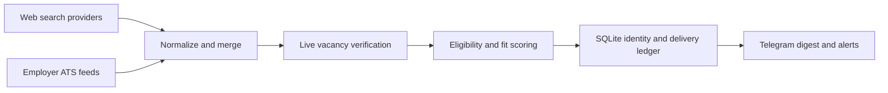

# Career Search Agent

A privacy-conscious, search-only career agent for discovering early-career technology roles in Singapore. It combines direct employer applicant-tracking-system feeds with multiple web-search providers, verifies that vacancy pages are still open, scores degree and career-stage fit, suppresses duplicates, and delivers qualified opportunities through Telegram.

This repository is a sanitized project edition. It contains no resume, contact details, API credentials, application history, generated job data, or private candidate profile.

## Highlights

- Direct ATS monitoring for Greenhouse, Lever, Ashby, SmartRecruiters, Workable, Workday, and SuccessFactors
- Provider fallback across Tavily, SerpApi, Jina Reader, Firecrawl, and Apify
- Singapore location, early-career, degree-fit, eligibility, and live-page checks
- Stable job identities and cross-source duplicate merging
- Permanent Telegram delivery ledger to prevent repeated listings
- Rapid employer-feed watcher plus a deeper on-demand search
- Atomic delivery claims, bounded retention, and log sanitization
- Search-only safety model: the agent does not fill forms or submit applications

## Architecture



See [Architecture](docs/ARCHITECTURE.md) for the full pipeline and module map.

## Quick Start

Requirements:

- Python 3.11 or newer
- Windows for DPAPI-backed secret storage; environment variables also work on other platforms
- A Telegram bot and chat ID for notifications
- At least one configured search provider

```powershell
git clone https://github.com/your-account/career-search-agent.git
cd career-search-agent
python -m venv .venv
.\.venv\Scripts\Activate.ps1
python -m pip install -r requirements.txt
Copy-Item .env.example .env
Copy-Item profile\eligibility_profile.example.json profile\eligibility_profile.json
Copy-Item profile\evidence_catalog.example.json profile\evidence_catalog.json
```

Edit the two files under `profile/` with your own eligibility and evidence. Keep them local; `.gitignore` excludes them.

### Secure Configuration On Windows

Store secrets with Windows DPAPI instead of committing them to `.env`:

```powershell
python .\scripts\secure_config.py set TAVILY_API_KEY
python .\scripts\secure_config.py set TELEGRAM_BOT_TOKEN
python .\scripts\secure_config.py set TELEGRAM_CHAT_ID
python .\scripts\secure_config.py status
```

The additional supported keys are `SERPAPI_KEY`, `JINA_API_KEY`, `FIRECRAWL_API_KEY`, and `APIFY_TOKEN`.

## Usage

Run a complete search without Telegram delivery:

```powershell
powershell -NoProfile -ExecutionPolicy Bypass -File .\scripts\daily_search.ps1 -SkipTelegram
```

Start the Telegram command listener:

```powershell
powershell -NoProfile -ExecutionPolicy Bypass -File .\scripts\start_telegram_career_agent.ps1
```

Telegram commands:

| Command | Action |
|---|---|
| `SEARCH` | Run the complete discovery and verification workflow, then send all qualified unseen jobs. |
| `LATEST` | Send all qualified unseen jobs from the latest completed search. |
| `PROVIDERS` | Show provider availability and recent fallback status without exposing secrets. |
| `WATCH START` | Enable rapid employer-feed monitoring. |
| `WATCH STOP` | Pause rapid monitoring. |
| `WATCH NOW` | Run one direct ATS scan immediately. |
| `WATCH STATUS` | Show watcher health and source coverage. |
| `STATUS` | Show search freshness and delivery-ledger status. |
| `STOP AGENT` | Stop the Telegram listener. |

`TOP10`, `TOP5`, and `DIGEST` are retained as compatibility aliases for `LATEST`; they do not cap the number of qualified results.

## Data And Privacy

Runtime outputs are intentionally excluded from version control. This includes SQLite databases, job snapshots, logs, generated digests, candidate profiles, resumes, cover letters, prompts, and application artifacts.

Read [Security and Privacy](docs/SECURITY.md) before deploying the agent or publishing a fork.

## Tests

```powershell
python -m unittest discover -s tests -q
```

The tests cover provider fallback, stable job identity, duplicate suppression, atomic delivery claims, ATS parsing, feed discovery, and secure-key support.

## Project Scope

This project discovers and reports opportunities. It deliberately does not log into employer portals, solve CAPTCHAs, fill sensitive fields, or submit applications.
